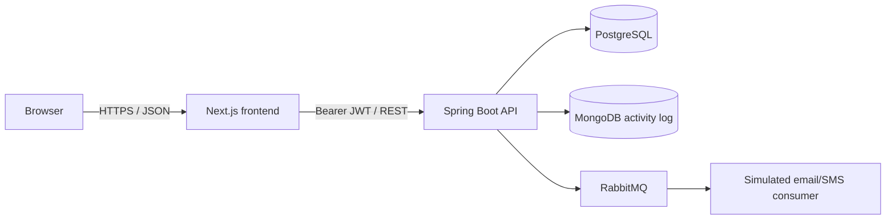

# TapWallet

[](https://github.com/pac-cee/TapWallet-springboot-AIC/actions/workflows/ci.yml)

TapWallet is a full-stack academic payment platform for wallet-to-merchant transactions. Customers can review their wallet, pay registered merchants, and inspect their own history. Merchants receive a business-scoped sales view. Administrators manage accounts, wallets, balances, merchants, reversals, audit activity, and date-filtered reports.

The application uses Next.js, Spring Boot, PostgreSQL, MongoDB, RabbitMQ, and Docker Compose. A dependency-free classroom mode replaces the external infrastructure with H2 and in-memory adapters.

## Run with Docker

Requirements: Docker Desktop with Docker Compose.

```bash
cp .env.example .env
# Set JWT_SECRET in .env to a stable random value of at least 32 characters.
docker compose up --build -d
docker compose ps
```

Open:

- Web application: `http://localhost:3000`
- API health: `http://localhost:8080/actuator/health`
- RabbitMQ management: `http://localhost:15672`

All five services should report healthy: frontend, backend, PostgreSQL, MongoDB, and RabbitMQ.

## Demo accounts

These accounts are seeded for local demonstration only.

| Role | Email | Password |
|---|---|---|
| Administrator | `admin@tapwallet.rw` | `Admin@123` |
| Customer | `alice@tapwallet.rw` | `Pass@123` |
| Customer | `eric@tapwallet.rw` | `Pass@123` |
| Merchant | `cafe@tapwallet.rw` | `Pass@123` |
| Merchant | `shop@tapwallet.rw` | `Pass@123` |

## Architecture



The backend is layered so HTTP handling, use cases, business state, and infrastructure remain separate:

```text
controller -> service -> domain/repository ports -> PostgreSQL, MongoDB, RabbitMQ
```

Important implementation boundaries:

- PostgreSQL is the operational source of truth for users, wallets, merchants, and payments.
- MongoDB stores flexible administrative and financial activity documents.
- RabbitMQ decouples payment/reversal events from notification delivery.
- Spring Security validates signed bearer JWTs and applies ADMIN, CUSTOMER, and MERCHANT permissions.
- External email/SMS delivery and real bank or mobile-money settlement are intentionally outside this academic scope.

## Core business behavior

- TapWallet supports RWF only; amounts must be positive and wallets cannot overdraw.
- A customer may own one wallet and cannot top it up directly. Balance changes are administrator-controlled.
- The signed token determines the customer's wallet or merchant business; client-supplied actor IDs are not trusted.
- A payment atomically debits the wallet, credits merchant revenue, and creates its payment record.
- A completed payment can be reversed by an administrator exactly once.
- Frozen users, wallets, and merchants cannot transact.
- Optimistic locking prevents concurrent balance or reversal updates from silently overwriting each other.
- Reports are read-only, administrator-only, limited to 366 days, and export the same period as CSV.

## Main API areas

| Area | Endpoints | Access |
|---|---|---|
| Authentication | `POST /api/auth/login` | Public |
| Current actor | `/api/me/**` | Authenticated actor |
| Customer payment | `POST /api/me/payments` | CUSTOMER |
| Resource administration | `/api/users`, `/api/wallets`, `/api/merchants`, `/api/payments` | ADMIN |
| Audit activity | `/api/activity` | ADMIN |
| Reports | `/api/reports/summary`, `/api/reports/payments.csv` | ADMIN |

Protected requests use `Authorization: Bearer <accessToken>`. Missing authentication returns `401`; insufficient permission returns `403`; business-rule failures return `422`.

## Verification

```bash
# Backend tests
mvn test

# Frontend static verification
cd frontend
bun install --frozen-lockfile
bun run lint
bun run typecheck
bun run build

cd ..

# Docker runtime and performance checks
python3 scripts/runtime_smoke.py
python3 scripts/performance_smoke.py --requests 200 --concurrency 100 --p95-ms 500
```

The recorded submission result is 25 passing backend tests, a successful 9-page frontend production build, five healthy containers, and 200/200 successful performance requests at concurrency 100.

Import [`postman/TapWallet.postman_collection.json`](postman/TapWallet.postman_collection.json) for the complete authenticated API workflow and role checks.

## Classroom mode without Docker

Requirements: Java 17, Maven, and Bun.

```bash
# Terminal 1
mvn spring-boot:run

# Terminal 2
cd frontend
bun install --frozen-lockfile
bun run dev
```

This mode uses H2, the in-memory activity adapter, and the in-memory notification publisher.

## Documentation

| Document | Purpose |
|---|---|
| [Final submission report](output/pdf/TapWallet_Web_Technology_Project_Report.pdf) | Polished report with requirements, UML, ERD, architecture, flows, security, testing, and traceability. |
| [Editable project report](docs/PROJECT_REPORT.md) | Source report with GitHub-rendered Mermaid diagrams. |
| [Business rules](docs/BUSINESS_RULES.md) | Money, payment, reversal, access, reporting, and infrastructure boundaries. |
| [Testing and QA](docs/TESTING.md) | Automated commands, risk coverage, responsive checks, and recorded evidence. |
| [Deployment runbook](docs/DEPLOYMENT.md) | Runtime modes, operations, production checklist, and rollback. |
| [Performance evidence](docs/PERFORMANCE.md) | Reproducible load-smoke method and measured results. |
| [UI design record](docs/UI_DESIGN.md) | Visual direction, responsive behavior, and accessibility decisions. |

## Project information

- Student: Pacifique Bakundukize (26798)
- Course: Web Technology, 2026-2027
- Instructor: Jeremie U. Tuyisenge
- Delivery branch: `feature/tapwallet-submission`
