# TapWallet Web Technology Project Report

**Student:** Pacifique Bakundukize (26798)  
**Course:** Web Technology  
**Instructor:** Jeremie U. Tuyisenge  
**Academic year:** 2026-2027  
**Project:** TapWallet - secure digital wallet and merchant payments

## 1. Executive summary

TapWallet is a responsive web application that lets customers hold a digital wallet, pay registered merchants, and review transaction history. Merchants can monitor received payments and revenue. Administrators control users, merchants, account status, reversals, and audit activity.

The solution deliberately follows the layered organization used in the lecturer's Spring Boot demonstration: domain entities, repositories, services, and thin controllers. It adds a Next.js frontend, OAuth2 Resource Server-compatible bearer JWT authentication, RBAC, relational and document persistence, event publishing, automated tests, Docker Compose, and continuous integration.

## 2. Problem definition

### 2.1 Problem statement

Customers and small merchants need a simple way to make and track local digital payments without relying on cash records or disconnected spreadsheets. Existing manual processes make balances difficult to verify, offer weak accountability when a payment is reversed, and expose business information to people who should not see it.

TapWallet provides one secure source of truth for wallet balances, merchant revenue, payment history, account status, and administrative actions.

### 2.2 Target users

| Actor | Need |
|---|---|
| Customer | See a wallet balance, pay an active merchant, and verify personal payment history. |
| Merchant | See business revenue and payments received without seeing another merchant's data. |
| Administrator | Manage users and merchants, freeze risky accounts, reverse payments, and inspect audit activity. |

### 2.3 Objectives

1. Make a wallet-to-merchant payment in one clear responsive flow.
2. Preserve financial consistency: wallet debit, merchant credit, and payment record succeed or fail together.
3. Restrict protected operations by role and by the current authenticated user.
4. Store operational entities relationally and flexible activity documents non-relationally.
5. Publish and consume channel-specific email/SMS notification events through replaceable ports, with RabbitMQ in the infrastructure profile.
6. Provide a zero-install classroom mode and a production-like Docker mode.
7. Keep the code testable, understandable, and close to the patterns taught in class.
8. Give administrators date-filtered operational and financial reports with CSV export.

### 2.4 Scope

**Included**

- Email/password sign-in and signed bearer access tokens.
- ADMIN, CUSTOMER, and MERCHANT roles.
- User, wallet, merchant, and payment management.
- Administrator-controlled wallet top-up and withdrawal, customer payment, and one-time reversal.
- Account and merchant activation/freezing.
- Customer, merchant, and administrator dashboards.
- Relational operational data and document-oriented audit data.
- Email/SMS notification events using in-memory and RabbitMQ adapters, with a safe simulated consumer.
- Administrator reporting for users, merchants, balances, completed/reversed volume, daily totals, top merchants, and CSV export.
- Responsive Next.js frontend, REST API, Postman collection, tests, containers, and CI.

**Excluded from this academic version**

- Real mobile-money or bank settlement.
- Real email/SMS providers; the project publishes notification events but does not send paid messages.
- KYC verification, transaction fees, exchange rates, chargebacks, and multi-factor authentication.
- Production custody of money. All balances are demonstration values.

## 3. Requirements

### 3.1 Functional requirements

| ID | Requirement | Verification |
|---|---|---|
| FR-01 | A registered active user can sign in and receive a time-limited bearer token. | Authentication integration test and Postman login. |
| FR-02 | The API restricts protected resources using ADMIN, CUSTOMER, and MERCHANT roles. | RBAC integration test and HTTP 401/403 checks. |
| FR-03 | An administrator can create, read, update, freeze, activate, and delete eligible users. | Controller tests and admin UI. |
| FR-04 | An administrator can create, read, update, freeze/activate, and safely delete merchants and wallets. | Controller tests and admin UI. |
| FR-05 | A customer can see only the wallet resolved from the token's user id. | `/api/me/wallet` and security test. |
| FR-06 | A customer can pay an active merchant when the wallet has sufficient funds. | Payment service/controller tests and customer UI. |
| FR-07 | Payment creation atomically debits the wallet, credits merchant revenue, and records the payment. | Transactional service test. |
| FR-08 | An administrator can reverse a completed payment exactly once. | Payment reversal tests. |
| FR-09 | A merchant can see only the business and payments resolved from the token's user id. | `/api/me/merchant` and `/api/me/payments`. |
| FR-10 | Administrative and financial activity is stored as flexible documents. | Activity-store adapter and admin activity endpoint. |
| FR-11 | Payment events are published and consumed as email/SMS notification work. | In-memory publisher in class mode; RabbitMQ publisher and simulated delivery consumer in Docker mode. |
| FR-12 | Validation and business-rule failures return consistent JSON errors. | Validation, conflict, not-found, and rule tests. |
| FR-13 | The web interface gives field-level errors, session-expiry handling, confirmation dialogs, and success/error notifications. | Frontend interaction and visual QA. |
| FR-14 | An administrator can generate a date-filtered operational report and export its payment rows. | `/api/reports/summary`, `/api/reports/payments.csv`, and Reports UI. |

### 3.2 Measurable quality attributes

| Attribute | Target | Design response |
|---|---|---|
| Usability | A first-time demo user can sign in and start a payment in no more than 3 visible actions. | Demo-role switch, balance-first dashboard, direct Pay action. |
| Responsive design | No horizontal page overflow at 360 px, 768 px, or 1440 px; data tables may scroll inside their own region. | Mobile bottom navigation, fluid typography, scoped table overflow. |
| Performance | Typical read requests target p95 below 500 ms with 100 concurrent classroom users; frontend production build uses compression and static assets. | Indexed lookups, bounded activity queries, response compression, Next.js standalone build; measured p95 153.35 ms for 200 authenticated requests at concurrency 100. |
| Reliability | A failed payment must not leave wallet and merchant totals inconsistent. | One `@Transactional` service operation and database constraints. |
| Security | Protected API requests without a valid token return 401; wrong roles return 403; passwords are never returned or stored in plaintext. | Spring Security Resource Server, RBAC matchers, BCrypt, `@JsonIgnore`. |
| Maintainability | Controllers contain transport logic only; business rules remain in services/domain. | Layered package structure and dependency injection. |
| Testability | Critical business and security paths are automated and runnable with one command. | Maven integration tests, frontend lint/typecheck/build, CI. |
| Deployability | Full stack starts with one Compose command and exposes health checks. | Multi-stage images, Compose dependencies, `/actuator/health`. |

## 4. User stories and acceptance criteria

### US-01 - Customer pays a merchant

**As a customer, I want to pay an active merchant from my wallet so that I can complete a purchase without cash.**

- Given an active customer, active wallet, active merchant, and sufficient funds, when the customer confirms a positive amount, then one completed payment is created, the wallet is debited, merchant revenue is credited, an audit document is saved, and a notification event is published.
- Given insufficient funds, when payment is attempted, then the API returns 422 and no balance or revenue changes.
- Given a frozen wallet, owner, or merchant, when payment is attempted, then the API returns 422 and no payment is created.

### US-02 - Merchant reviews receipts

**As a merchant, I want to view only my shop and incoming payments so that I can reconcile sales safely.**

- Given an authenticated merchant, when the dashboard opens, then the API derives the shop from the token user id rather than accepting a browser-supplied shop id.
- The merchant sees revenue, payment reference, payer, date, amount, and status.
- A merchant cannot access admin user-management resources.

### US-03 - Administrator controls risk

**As an administrator, I want to freeze accounts and reverse an incorrect payment so that protected operations remain controlled and auditable.**

- An administrator can freeze or activate eligible users and merchants.
- A completed payment may be reversed once; a second reversal returns 422.
- A reversal refunds the wallet, deducts merchant revenue, records audit activity, and publishes an event.
- Customers and merchants receive 403 when they request admin-only resources.

### US-04 - Administrator reviews operations

**As an administrator, I want a date-filtered summary and downloadable payment rows so that I can reconcile activity and prepare evidence without direct database access.**

- The default period is the latest 30 calendar days; custom periods are inclusive and limited to 366 days.
- The summary separates completed and reversed counts and volume, shows current wallet balances and merchant revenue, and ranks the top five merchants.
- The CSV export uses the same period and safely quotes text fields.
- Customers and merchants receive 403 for both reporting endpoints.

## 5. Domain model

### 5.1 Principal domain concepts

**Actors:** customer, merchant operator, administrator.  
**Processes:** authenticate, open/manage wallet, administrator top-up/withdrawal, pay merchant, reverse payment, freeze/activate, report, audit, publish/consume notification.
**Data objects:** user, wallet, merchant, payment, activity document, notification event, access token.

The domain is independent of the interface. A `PaymentService` coordinates the wallet and merchant aggregates inside one relational transaction. Document and messaging technologies sit behind ports, so classroom and infrastructure adapters can be exchanged without changing payment rules.

### 5.2 UML class diagram

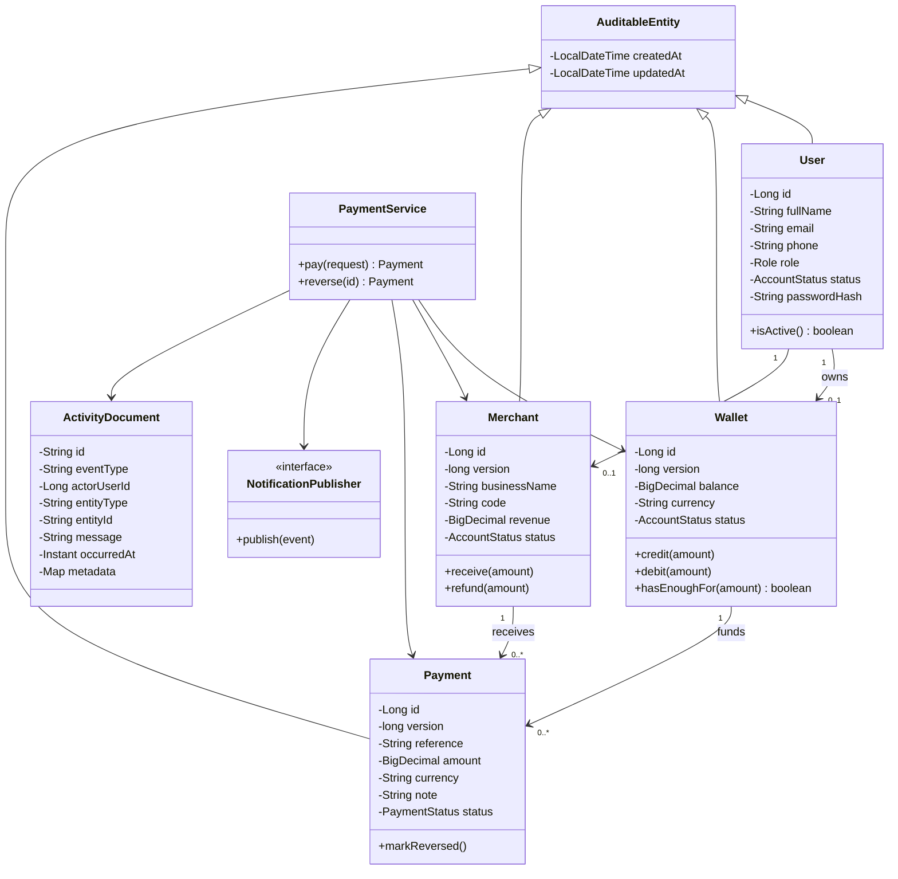

### 5.3 ER diagram - relational operation data

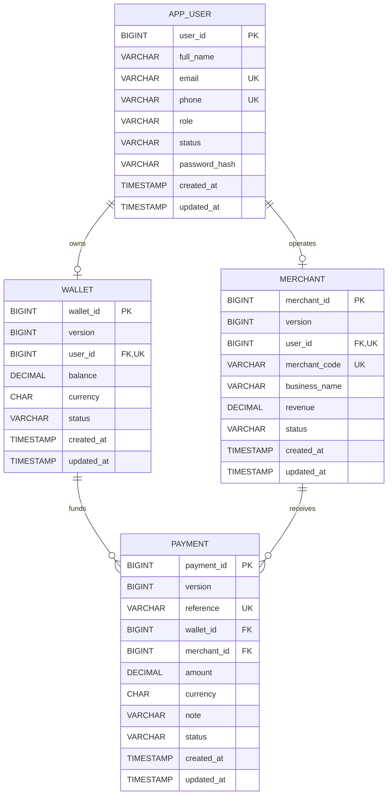

### 5.4 Technology-oriented relational schema

| Table | Primary key | Foreign keys | Constraints and indexes |
|---|---|---|---|
| `app_user` | `user_id` | - | Unique `email`; unique `phone`; non-null role/status/password hash; bounded column lengths. |
| `wallet` | `wallet_id` | `user_id → app_user.user_id` | Unique owner; non-null RWF balance/status; optimistic `version`; decimal precision 19,2. |
| `merchant` | `merchant_id` | `user_id → app_user.user_id` | Unique operator; unique merchant code; non-null revenue/status; optimistic `version`. |
| `payment` | `payment_id` | `wallet_id → wallet.wallet_id`; `merchant_id → merchant.merchant_id` | Unique reference; non-null amount/currency/status; optimistic `version`; indexes on wallet/date, merchant/date, and status/date. |

H2 supplies the default in-memory relational database. The `postgres` profile uses PostgreSQL with the same JPA mappings.

### 5.5 Non-relational document model

MongoDB collection: `activity_log`

```json
{
  "_id": "uuid",
  "eventType": "PAYMENT_COMPLETED",
  "actorUserId": 2,
  "entityType": "Payment",
  "entityId": "41",
  "message": "Payment TXN-ABC12345 completed",
  "occurredAt": "2026-10-03T12:00:00Z",
  "metadata": {
    "amount": "5000.00",
    "currency": "RWF",
    "merchantCode": "CAF-001"
  }
}
```

Indexes: individual indexes on `eventType`, `actorUserId`, and `occurredAt`, plus compound event/date and actor/date indexes. Mongo automatic index creation is enabled in the infrastructure profile. Metadata remains flexible for new event types. In the default profile, the same document contract is implemented with a thread-safe in-memory store. The `mongodb` profile activates the Spring Data MongoDB adapter.

## 6. Use cases and system design

### 6.1 Use-case view

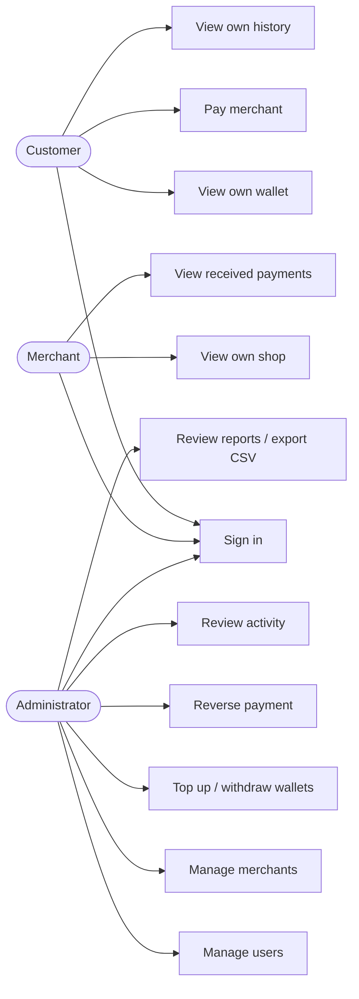

### 6.2 System context

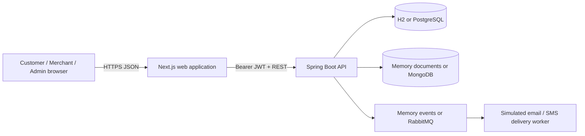

### 6.3 Layered backend architecture

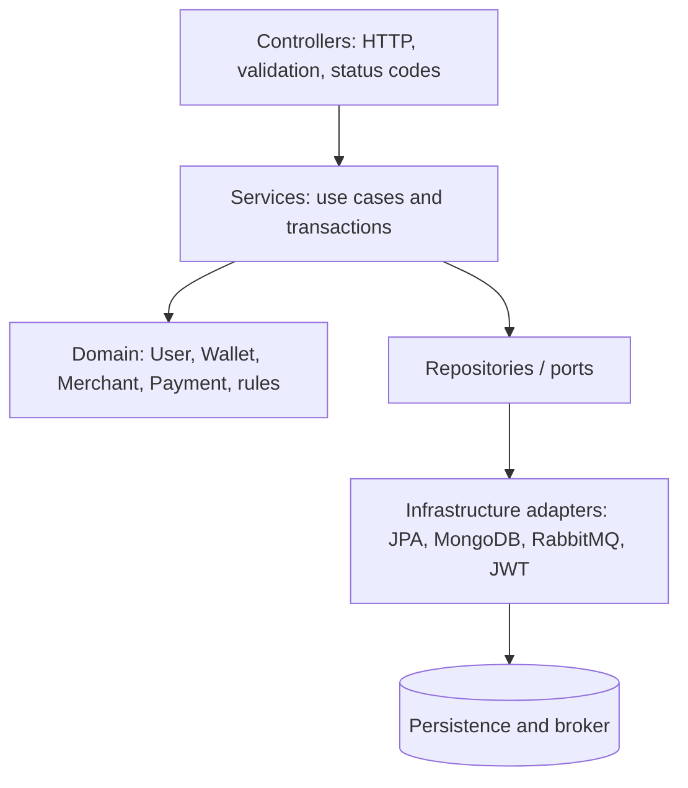

### 6.4 Authentication sequence

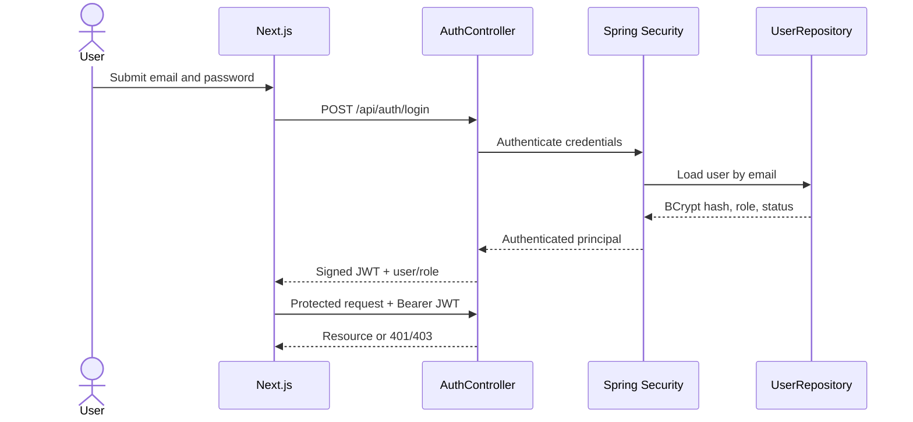

### 6.5 Payment sequence

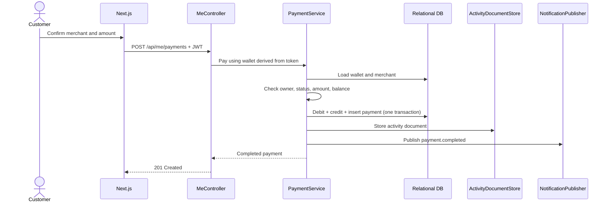

### 6.6 Payment lifecycle

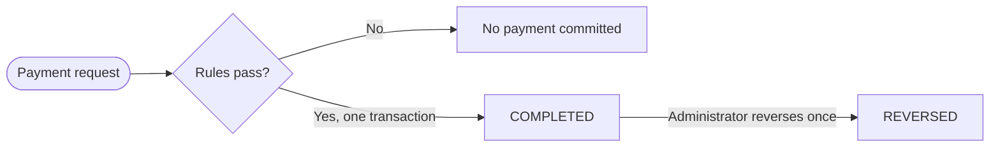

Validation and business-rule failures occur before a payment record is committed. The system therefore does not create `FAILED` financial rows for rejected requests. Reversal preserves the original record and changes its state instead of deleting history.

### 6.7 Notification event flow

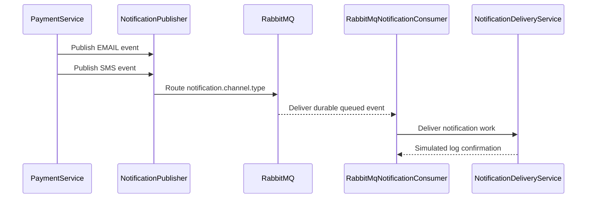

The service depends on interfaces rather than a vendor SDK. The Docker profile uses RabbitMQ and a logging delivery adapter; a future approved provider can replace only the delivery implementation. No Gmail or SMS credentials are stored.

### 6.8 Reporting sequence

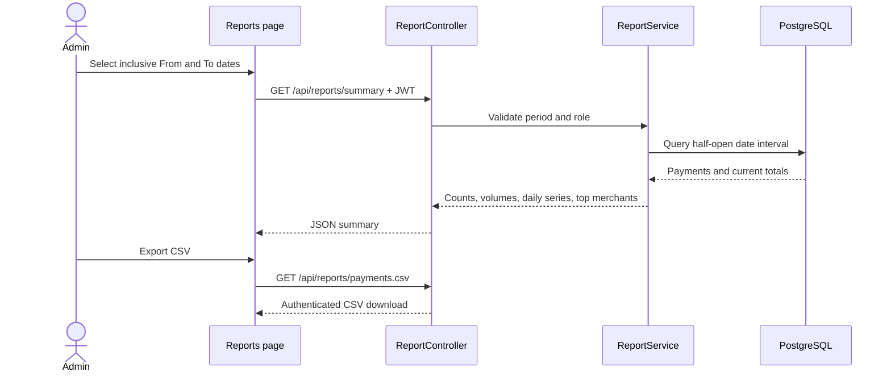

### 6.9 Implementation map

| Concern | Main code location |
|---|---|
| Authentication and RBAC | `config/SecurityConfig.java`, `security/JwtService.java`, `controller/AuthController.java` |
| Actor-scoped customer/merchant access | `controller/MeController.java`, `security/CurrentActorService.java` |
| Payment and reversal rules | `service/PaymentService.java`, `domain/Payment.java`, `domain/Wallet.java`, `domain/Merchant.java` |
| Administrative resource rules | `service/UserService.java`, `service/WalletService.java`, `service/MerchantService.java` |
| Reporting | `controller/ReportController.java`, `service/ReportService.java`, `frontend/app/(app)/reports/page.tsx` |
| Activity documents | `service/ActivityLogService.java`, `document/ActivityDocument.java` |
| Notification events | `event/NotificationPublisher.java`, `event/RabbitMqNotificationPublisher.java`, `event/RabbitMqNotificationConsumer.java` |
| Consistent API failures | `exception/GlobalExceptionHandler.java`, `exception/ApiError.java` |
| Deployment and CI | `Dockerfile`, `frontend/Dockerfile`, `compose.yaml`, `.github/workflows/ci.yml` |

## 7. Security and authorization

### 7.1 RBAC matrix

| Capability | ADMIN | CUSTOMER | MERCHANT |
|---|:---:|:---:|:---:|
| Manage users/wallets/merchants | Yes | No | No |
| View own wallet | No | Yes | No |
| Top up or withdraw a customer wallet | Yes | No | No |
| Pay merchant | Optional admin API / Yes through customer UI | Yes | No |
| View own received payments | All payments | Own wallet only | Own shop only |
| Reverse payment | Yes | No | No |
| View audit documents | Yes | No | No |
| Generate reports / export CSV | Yes | No | No |

### 7.2 Security controls

- BCrypt password hashing; hashes are excluded from JSON serialization.
- Stateless signed HS256 bearer JWTs with issuer, subject, audience, expiry, user id, name, and roles.
- Spring Security OAuth2 Resource Server validates every protected request.
- Route-level RBAC returns 401 for missing/invalid authentication and 403 for the wrong role.
- Security-generated 401/403 responses use the same JSON error shape as application failures.
- Actor-scoped `/api/me/**` endpoints derive user identity from the signed token, not from client-controlled ids.
- Bean Validation rejects malformed payloads before services execute.
- Service rules protect invariants even if another interface is added later.
- Optimistic version columns prevent concurrent balance/revenue/reversal updates from silently overwriting one another.
- The academic scope supports RWF only so totals never combine incompatible currencies.
- Customers cannot mint demo funds; top-up and withdrawal remain administrator-controlled.
- Secrets come from environment variables in Docker; `.env` is ignored.
- CORS is restricted to the frontend origin for local development.

## 8. Frontend and responsive prototype

### 8.1 Research-backed direction

- Primary: Stripe-style dense transaction hierarchy and action-first payment records.
- Customer balance hierarchy: Wise-style prominent available balance with restrained quick actions.
- Merchant/admin tables: Paystack-style filterable transaction operations.
- Visual lock: light neutral canvas, one teal interaction color, system sans typography, restrained borders, limited elevation, and product data instead of decorative imagery.
- The admin workspace provides functional CRUD for users, merchants, and wallets, controlled balance operations, and payment reversal.
- The reports workspace provides explicit period filters, financial/operational metrics, a compact daily-volume visualization, top-merchant ranking, and authenticated CSV export.
- Mutating actions use confirmation dialogs where destructive, inline field errors where corrective, and brief toast notifications for outcomes.

### 8.2 Desktop wireframe

```text
┌────────────────┬───────────────────────────────────────────────────────┐
│ TapWallet      │ Good morning, Alice                                  │
│                │ Your wallet                                           │
│ Overview       │ ┌───────────────────────────────────────────────────┐ │
│ Pay            │ │ Available balance                   [Pay merchant] │ │
│ Activity       │ │ RWF 50,000                                        │ │
│                │ └───────────────────────────────────────────────────┘ │
│                │ Spent          Active merchants          Account     │
│ Alice          │ ───────────────────────────────────────────────────── │
│ customer       │ Recent activity                                     │
│ [Sign out]     │ Reference     Merchant      Status        Amount     │
└────────────────┴───────────────────────────────────────────────────────┘
```

### 8.3 Mobile wireframe

```text
┌────────────────────────────┐
│ TapWallet         CUSTOMER │
│                            │
│ Good morning, Alice        │
│ Your wallet                │
│ ┌────────────────────────┐ │
│ │ Available balance      │ │
│ │ RWF 50,000             │ │
│ │ [ Pay a merchant ]     │ │
│ │ View activity          │ │
│ └────────────────────────┘ │
│                            │
│ Recent activity            │
│ [scrollable transaction]   │
├────────────────────────────┤
│ Overview  Pay  Activity    │
└────────────────────────────┘
```

## 9. Performance and reliability

- Database uniqueness constraints prevent duplicate email, phone, merchant code, wallet owner, and merchant operator data.
- Composite payment indexes support wallet, merchant, status, and reporting-date queries; Mongo compound indexes support recent event/actor audit queries.
- Payment operations use Spring transactions and short service methods.
- User/owner/operator lookups use unique indexed columns.
- Activity retrieval is bounded to the latest 100 documents.
- Frontend requests independent resources concurrently with `Promise.all`.
- Server compression is enabled for responses above 1 KB.
- Stateless authentication supports horizontal API scaling.
- Docker health checks and restart policies detect and recover failed processes.

## 10. Testing and quality assurance

| Layer | Coverage |
|---|---|
| Controller/integration | CRUD success, validation, duplicates, missing resources, freezes, balances, payment, and reversal. |
| Security integration | Login, JWT issuance, JSON 401/403 errors, raw-payment denial, admin access, customer-owned wallet access. |
| Frontend static quality | ESLint, TypeScript strict mode, and production build. |
| API workflow | Importable Postman collection with token capture and role examples. |
| Deployment | `docker compose config`, image builds, and service health checks. |
| Continuous integration | Maven verify, frontend lint/typecheck/build, Compose validation, and image builds on push/PR. |
| Performance | Dependency-free authenticated load check with configurable request count, concurrency, and p95 threshold. |

Exact commands and recorded results are maintained in [TESTING.md](TESTING.md).

## 11. DevOps and delivery

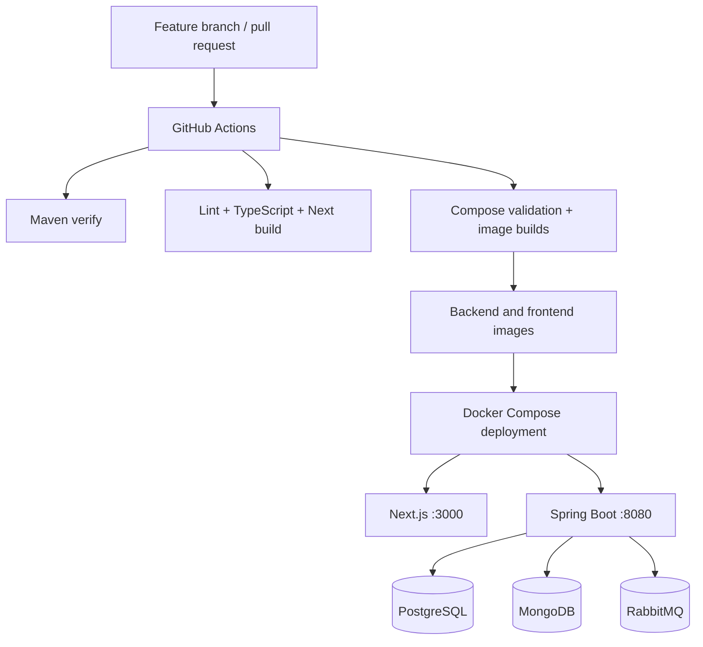

The Docker runbook is in [DEPLOYMENT.md](DEPLOYMENT.md).

## 12. Git workflow

- `main` remains the stable integration branch.
- Work is implemented on `feature/tapwallet-submission`.
- Commits are grouped by coherent outcomes: backend/security, frontend, DevOps, and documentation/tests.
- GitHub Actions verifies pushes and pull requests.
- Completion is submitted as a pull request into `main`; review/CI happens before merge.

## 13. Requirement traceability

| PDF item | Evidence |
|---|---|
| 1. Problem, users, objectives, scope, requirements, quality, stories | Sections 2-4. |
| 2a. ER/UML model | Sections 5.2 and 5.3. |
| 2b. Abstract domain concepts | Section 5.1. |
| 2c. Technology schema, keys, constraints/indexes | Sections 5.4 and 5.5. |
| 3. Responsive modern frontend and wireframes | Next.js app and Section 8. |
| 4. Backend architecture/framework | Spring Boot layered architecture, Section 6.3. |
| 5. Relational and non-relational databases | H2/PostgreSQL + memory/MongoDB document adapters, Sections 5.3-5.5. |
| 6. Secure authentication including OAuth2, performance | OAuth2 Resource Server JWT, BCrypt, RBAC, Sections 7 and 9. |
| 7. RabbitMQ for events | RabbitMQ profile, exchange, durable queue, channel-specific publisher, consumer, and simulated email/SMS delivery adapter. |
| 8. RBAC | Security rules, role claims, actor-scoped endpoints, Section 7. |
| 9. Git and pull request | Feature branch, meaningful commits, CI, PR workflow, Section 12. |
| Bonus: DevOps/deployment | Dockerfiles, Compose, health checks, GitHub Actions. |
| Bonus: testing/QA | Backend integration tests, frontend static checks, Postman, CI. |
| Bonus: new technology | Next.js App Router, adapter-based dual runtime, document audit trail. |

## 14. Demonstration script

1. Start locally with H2 and in-memory adapters or start the full Compose stack.
2. Open `http://localhost:3000` and sign in as Alice (customer).
3. Show the balance-first responsive dashboard and create a merchant payment.
4. Open Activity and verify the payment.
5. Sign in as the merchant and show that only the merchant's shop/payments are visible.
6. Sign in as admin; show user/merchant controls, all payments, document audit activity, and date-filtered Reports with CSV export.
7. Import the Postman collection, log in, and demonstrate 401, 403, validation, insufficient funds, and one-time reversal.
8. Show H2/PostgreSQL operational records, MongoDB activity documents, and the RabbitMQ management UI/queue in full-infrastructure mode.
9. Run automated verification, the 100-concurrency performance check, and show the GitHub Actions workflow and pull request.

## 15. Reporting and business-control completion

The reporting module is intentionally read-only and ADMIN-only. A selected inclusive date range (maximum 366 days) is converted to a half-open database interval, preventing end-of-day records from being omitted. It returns user and merchant activity counts, current wallet and merchant totals, completed and reversed payment counts/volume, daily completed volume, and the top five merchants. The CSV endpoint applies the identical period rule and safely quotes text fields.

Business controls added during final completion include RWF-only balances, administrator-controlled balance funding, optimistic locking on mutable financial entities, broader MongoDB audit coverage, channel-specific email/SMS events, and a RabbitMQ consumer. Real external email/SMS delivery remains intentionally excluded; the logging delivery adapter demonstrates consumption without storing third-party credentials and can be replaced behind the existing interface.
